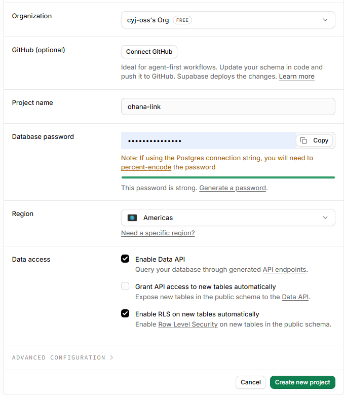

# Part 3 | Supabase Setup

[Back to start](README.md)

**Start after your Next.js app runs. Windows and Mac use this same page.**

**Finish line: A Supabase project, app connection settings, and an app that starts.** Database read/write testing comes later in the lesson.

## 1. Sign in and create a project

**Where: Your browser → [Supabase](https://supabase.com/)**

1. Select **Start your project**. Sign in or sign up; you may use your GitHub account.
2. Select your existing free organization or create one on the **Free** plan.
3. Open your existing **ohana-link** project, or create one with these settings:

| Setting | Choose |
| --- | --- |
| Project name | **ohana-link** |
| Database password | Generate one and save it in your password manager |
| Region | **Americas** |
| Data API | **Enabled** |
| Row Level Security (RLS) | **Enabled**, including automatic RLS if offered |

[](supabase-project-americas.png)

*Example screen. Use your own organization and password.*

Create the project and wait. If the free plan cannot create another project, ask for help before paying or deleting a project.

> **CHECK 1 — Your project dashboard is ready. Continue to Step 2.**

## 2. Copy Supabase's setup prompt

**Where: Your browser → Supabase project dashboard → Connect**

1. Click **Connect** at the top of your project.
2. Select **Framework**, then choose **Next.js** and **App Router**.
3. Click **Copy prompt** in the Connect panel. This copies the full setup instructions for Claude Code.

[](https://raw.githubusercontent.com/cyj-oss/itm325-vibecoding/main/image-supabase-copy-prompt.png)

*The section may be called Connect your app or Follow these steps. Use its Copy prompt button.*

<details>
<summary>See the Connect button and framework choices</summary>

[](https://raw.githubusercontent.com/cyj-oss/itm325-vibecoding/main/image-supabase-connect-button.png)

[](https://raw.githubusercontent.com/cyj-oss/itm325-vibecoding/main/image-supabase-nextjs-app-router.png)

</details>

> **CHECK 2 — You copied the full setup prompt. Continue to Step 3.**

## 3. Run the prompt and check the files

### A. Paste the copied prompt into Claude Code

1. In VS Code, open your existing **ohana-link** folder.
2. If Claude Code is not running, choose **Terminal → New Terminal**, type `claude`, and press **Enter**.
3. Paste the prompt you copied from Supabase into Claude Code. Use **Control+V** on Windows or **Command+V** on Mac, then press **Enter**.
4. Review the proposed changes and installation commands. Let Claude finish preparing the connection files.

> **Where to paste:** **Claude Code input** · in the VS Code terminal panel · in **ohana-link**
>
> Paste the **full prompt copied from Supabase**, not just the package-install command. You do not need to run the dashboard's installation commands separately.

### B. Check the generated files

1. In **VS Code → Explorer**, open **.env.local** in the **ohana-link** folder, beside **package.json**.
2. Confirm it contains these two settings with your own project's values:
   - **`NEXT_PUBLIC_SUPABASE_URL`** — your Project URL.
   - **`NEXT_PUBLIC_SUPABASE_PUBLISHABLE_KEY`** — your publishable key.
3. In Supabase, look under **Add files → .env.local** to compare the values. Keep correct values already in your file.
4. Open **.gitignore** and check that it includes `.env*`. Keep its other entries.

[](https://raw.githubusercontent.com/cyj-oss/itm325-vibecoding/main/image-supabase-env-local-english.png)

*Adapted example. Your file must contain your own project's values, not the placeholders in this image.*

<details>
<summary>See the .gitignore example</summary>

[](https://raw.githubusercontent.com/cyj-oss/itm325-vibecoding/main/image-supabase-gitignore-env.png)

</details>

> **CHECK 3 — Claude prepared the connection files, .env.local contains your project URL and publishable key, and .gitignore includes .env*. Continue to Step 4.**

<details>
<summary>If .env.local is missing or still has placeholders</summary>

If the file is missing, ask Claude to finish creating it in the project folder beside **package.json**.

If values are missing, return to Supabase's **Add files → .env.local** tab. Copy the **two complete lines**, including each name, `=`, and full value. Scroll horizontally if needed to reach the ends.

Replace the matching placeholder lines in your project's **.env.local**, preserve other settings, and save. The format is:

> **Where to paste:** VS Code editor · **.env.local** · beside **package.json**

```dotenv
NEXT_PUBLIC_SUPABASE_URL=https://your-project.supabase.co
NEXT_PUBLIC_SUPABASE_PUBLISHABLE_KEY=your-publishable-key
```

Use the **publishable key**, never a secret key, service_role key, or database password.

</details>

<details>
<summary>Which other files did Claude create?</summary>

You may see files such as **client.ts** and **server.ts** under **utils/supabase** or **lib/supabase**. The exact folder and helper names can vary. Follow Claude's change summary; you do not need to create duplicate files to match the example.

</details>

<details>
<summary>Is the publishable key a password?</summary>

No. It is intended for app code, including browser code. Database permissions and RLS policies control access to data. Secret keys and database passwords must stay private.

Supabase runs online; no local database server, Docker, or Supabase CLI is required here. Signing in with GitHub does not connect Supabase to your app.

</details>

## 4. Check the setup

Run commands outside Claude Code. **Copy both checks together:**

> **Where to paste:** VS Code terminal · **PowerShell on Windows / Zsh or Bash on Mac** · in **ohana-link**

```text
git check-ignore .env.local
git ls-files .env.local
```

> **CHECK — The first command prints .env.local. The second prints nothing.**

If either result differs, use [file help](HELP.md#files-that-should-not-be-uploaded) before publishing.

Stop the running development server with **Control+C**. Restart it in the **app's terminal** using only your computer's command:

> **Where to paste:** VS Code terminal · **PowerShell** · in **ohana-link**

```powershell
npm.cmd run dev
```

> **Where to paste:** VS Code terminal · **Zsh or Bash** · in **ohana-link**

```bash
npm run dev
```

**Where: Your browser**  
Open the **Local** address printed in the terminal. Check that the app starts without setup errors.

> **DONE — Check all three:**
>
> - Your Supabase project exists.
> - Connection files and real settings are saved; .env.local is ignored and untracked.
> - Your app starts.
>
> **Stop here for Part 3 setup.** This does not yet prove database reads or writes work.

[](https://cyj-oss.github.io/itm325-vibecoding/#lesson=8.2&step=0&resume=1)

<details>
<summary>When do we test reading and saving data?</summary>

In the database lesson, create the tables and access policies. Save a test item in the app, confirm it appears in Supabase, and reload the app to confirm it is read back. That is the final connection check.

</details>

[Need help?](HELP.md) · [Official Next.js connection guide](https://supabase.com/docs/guides/getting-started/quickstarts/nextjs) · [Supabase API keys](https://supabase.com/docs/guides/getting-started/api-keys)
